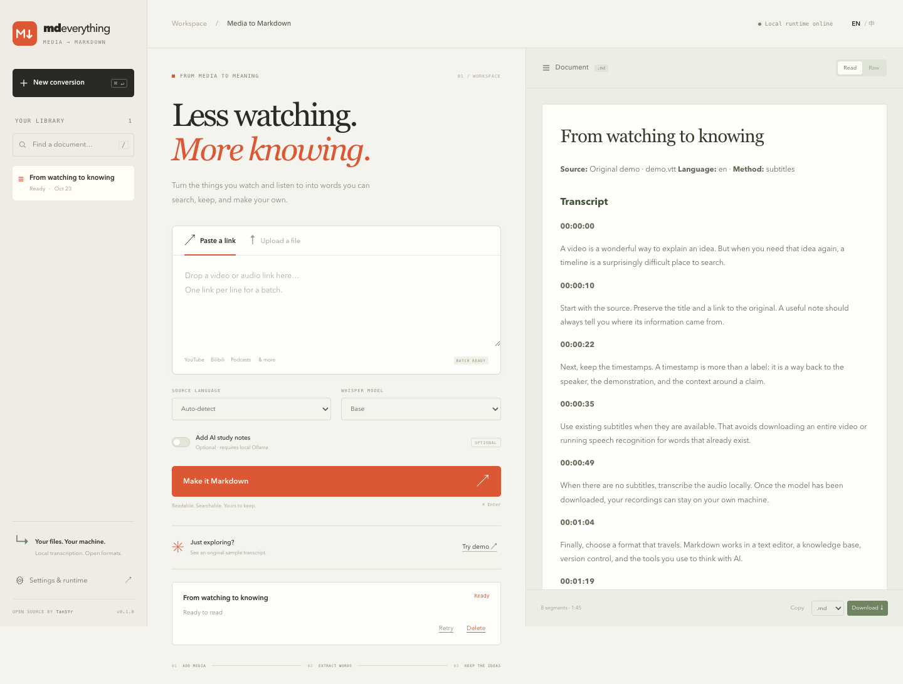
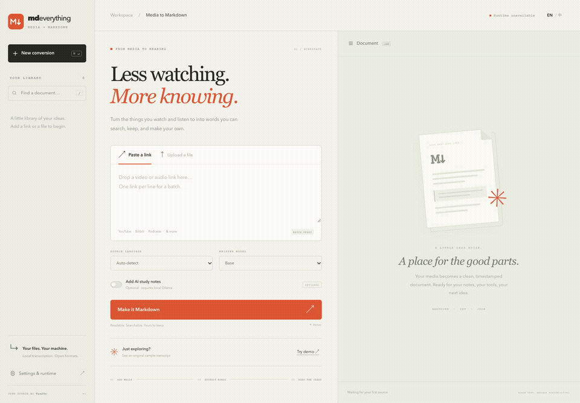

<div align="center">

# mdeverything

### Watch less. Keep more.

**Turn videos into documents you own.**<br>
Links, recordings and subtitles → clean, timestamped Markdown.

[](https://github.com/TanSYr/mdeverything/actions/workflows/ci.yml)
[](LICENSE)
[](https://github.com/TanSYr/mdeverything/releases/tag/v0.2.0)

**English** · [简体中文](README.zh-CN.md)<br>
[Get started](#get-started) · [Example output](examples/demo.md) · [Roadmap](docs/roadmap.md) · [Contribute](CONTRIBUTING.md)



</div>

A useful idea should not stay trapped in a timeline. Paste a video link or drop a recording. Keep its words, timestamps and source in a file you can search, cite, edit, and give to your AI tools.

**No account. No paid API key. Your files stay yours.**

> **Desktop preview · v0.2.0.** macOS and Windows installers include the speech engine and runtimes. No Python setup. Initial installers are unsigned; see the [installation guide](docs/installation.md#desktop-installers). Website compatibility depends on yt-dlp and can change; “everything” is the direction, not a guarantee that every link works.

### See the real workflow



## Why mdeverything?

- **Captions first.** Reuse existing subtitles when available. Skip speech inference and the media download when captions work.
- **Local speech recognition.** For recordings and videos without usable captions, run faster-whisper on your own CPU. Model weights download on first use.
- **Evidence stays attached.** Keep the full transcript, source metadata, available chapters, and timestamps. YouTube/Bilibili timestamps link back to the source; other sites link to the original page.
- **A workspace, not a command to memorize.** Batch links, drop files, follow real progress, cancel, retry, search history and preview the document.
- **Portable by default.** Download Markdown, SRT and JSON. Bring the Markdown to Obsidian, your editor, Git or an AI conversation.
- **Optional local AI notes.** Use your own Ollama model. Notes are labeled separately; the full transcript remains intact even if generation fails.
- **Start without a model.** The included original subtitle demo goes through the real conversion pipeline. No API key, account or model download needed to try it.

## Get started

**[Download the desktop app →](https://github.com/TanSYr/mdeverything/releases/tag/v0.2.0)**

1. Choose the macOS `.dmg` for **Apple Silicon (arm64)** or **Intel (x64)**, or the Windows **x64 `.exe`**.
2. Install and open mdeverything. Click **Try demo**, paste a video link, or drop a recording.
3. When speech recognition is needed, the app downloads your selected model automatically. **Settings → Speech models** also lets you prepare one in advance, see progress, cancel and resume. Then local recordings work offline.

The app includes Python, faster-whisper, FFmpeg and Node. You do **not** install those yourself. Model weights download separately: Tiny **75 MiB**, Base **141 MiB**, Small **464 MiB**, Medium **1.43 GiB**, Large v3 **2.88 GiB** (rounded). Captions and the demo need no speech model. AI notes remain an optional separate Ollama feature.

[Installation help and unsigned-app prompts →](docs/installation.md#desktop-installers)

### Run from source (developers)

Python **3.11–3.13** is the recommended runtime range. FFmpeg is recommended for media processing; `.srt`/`.vtt` conversion needs neither FFmpeg nor speech models.

```bash
git clone https://github.com/TanSYr/mdeverything.git
cd mdeverything
python -m venv .venv
source .venv/bin/activate       # Windows: .venv\Scripts\activate
pip install -e ".[transcribe]"
mde serve
```

Open **http://127.0.0.1:8765**, then click **Try the demo** or drop a file.

For YouTube, install **Deno 2.3+ or Node.js 22+** on PATH; the app detects it automatically. See [runtime setup](docs/installation.md#youtube-javascript-runtime).

For a lightweight captions/subtitles-only installation, use `pip install -e .`. Add transcription later with `pip install -e ".[transcribe]"`.

<details>
<summary><strong>Prefer uv?</strong></summary>

```bash
uv sync --extra transcribe
uv run mde serve
```

</details>

### Docker

Build from this repository. The image includes FFmpeg and local transcription support.

```bash
docker compose up --build -d
```

Open **http://127.0.0.1:8765**. Named volumes retain job history and model weights. Stop with `docker compose down`; adding `-v` also deletes those volumes. This is a single-user local app: do not expose its port publicly.

### Command line

```bash
# Convert the included subtitles — no model needed
mde convert examples/demo.vtt -o ./notes

# Captions first, local transcription fallback
mde convert "https://www.youtube.com/watch?v=VIDEO_ID" -o ./notes

# Your own recording
mde convert meeting.mp4 --language en --model small -o ./notes

# Batch: one URL or file path per line
mde convert --batch inputs.txt -o ./notes

# Check your environment
mde doctor
```

Every input gets its own folder containing `document.md`, `document.srt` and `document.json`. Existing output folders are never overwritten. CLI returns a nonzero exit code if any input fails.

[Full installation and troubleshooting guide →](docs/installation.md)

## What comes out?

```markdown
---
title: "From watching to knowing"
source: "demo.vtt"
language: "en"
method: "subtitles"
---

# From watching to knowing

## Transcript

**00:00:22**

Next, keep the timestamps. A timestamp is more than a label:
it is a way back to the speaker, the demonstration, and the
context around a claim.
```

Read the [complete generated example](examples/demo.md). All example text is original and included under this repository's MIT license.

## Supported inputs

| Input | How it works | Notes |
| --- | --- | --- |
| Video URLs | yt-dlp captions → audio → local Whisper | Individual videos, batch up to 20 links per request |
| MP4, MOV, MKV, WebM and other media | Local faster-whisper | CPU inference; speed depends on model and hardware |
| MP3, WAV, M4A, FLAC, OGG and other audio | Local faster-whisper | First use downloads model weights |
| SRT / WebVTT | Parse, deduplicate rolling captions, export | UTF-8; no model required |

The [yt-dlp supported-sites list](https://github.com/yt-dlp/yt-dlp/blob/master/supportedsites.md) is the upstream reference, **not a tested compatibility guarantee for this release**. Sites may require authentication or restrict access. Use only content you are authorized to access. DRM-protected content and active live streams are not supported.

**Not shipped yet:** playlist expansion, speaker diarization, translation, frame OCR, PDF/web-page conversion or hosted multi-user accounts. See the [roadmap](docs/roadmap.md).

## Optional: local AI notes

Install [Ollama](https://ollama.com/), download a model, then start the app with it configured:

```bash
ollama pull qwen3:8b
MDE_OLLAMA_MODEL=qwen3:8b mde serve
# Or: MDE_OLLAMA_MODEL=qwen3:8b mde convert meeting.wav --notes
```

Enable **Local AI notes** in the workspace. `MDE_OLLAMA_URL` defaults to `http://127.0.0.1:11434`. Long transcripts are processed in bounded chunks; notes may repeat across chunks. Generated notes are fallible and do not replace the transcript. Setting a remote Ollama URL sends transcript text to that configured server.

## Local by design

There is no analytics or telemetry. Desktop jobs and models live in the OS application data directory; source-edition jobs and uploads live in `~/.mdeverything` by default (change with `--data-dir` or `MDE_DATA_DIR`). Deleting a job removes its saved inputs and outputs. Website requests go to the source platform; model downloads go to the model host. Local recordings are processed on your machine. See [security and deployment boundaries](SECURITY.md).

## Build with us

```bash
pip install -e ".[dev]"
pytest
ruff check .
ruff format --check .
python -m build
```

[Contributing](CONTRIBUTING.md) · [Architecture](docs/design.md) · [Release process](docs/releasing.md) · [Report a bug](https://github.com/TanSYr/mdeverything/issues/new/choose)

Useful first contributions: a reproducible subtitle edge case, a clearer installation step, translation improvements, or a small independently tested input adapter. If this is useful to you, a **star** helps other people find it. A real bug report helps us make it better.

## Credits

Built by [TanSYr](https://github.com/TanSYr). Evolved from the author's **Video2Text** workflow. Inspired by [DownVid](https://github.com/Downvid/downvid)'s accessible video-tool experience; this is an independent implementation, not an affiliated product or a DownVid fork.

Powered by [yt-dlp](https://github.com/yt-dlp/yt-dlp), [faster-whisper](https://github.com/SYSTRAN/faster-whisper), [FastAPI](https://github.com/fastapi/fastapi) and [FFmpeg](https://ffmpeg.org/). [Third-party notices](THIRD_PARTY_NOTICES.md).

[MIT License](LICENSE).
